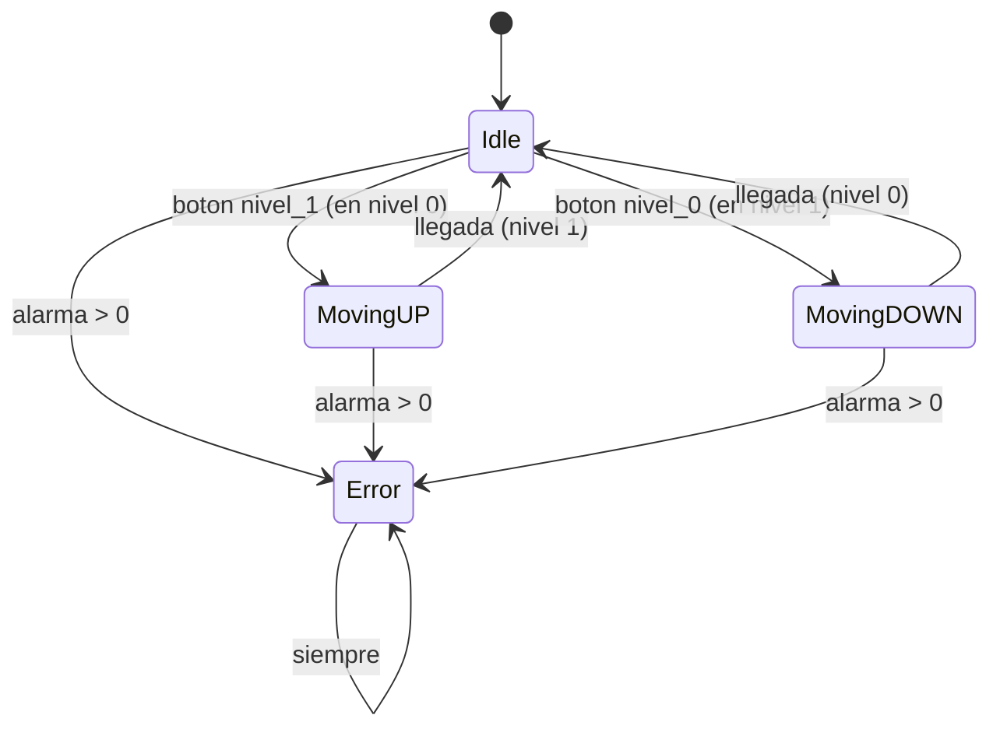

# Planificación de la solución: `gestor()`

Nombres literales del README: `Idle`, `MovingUP`, `MovingDOWN`, `Error`, `nivel_0`, `nivel_1`, `nivel_actual`.

## 1. Estados (`sealed class`) y enums para el resto

- `Estados` se mantiene como `sealed class` con `object Idle`, `MovingUP`, `MovingDOWN`, `Error`, con `onEnter()` dentro de cada estado.
- Los enums se usan para las variables (sustituyen los números mágicos):
  - `enum class Niveles(val valor: Int)`: `NIVEL_0(0)`, `NIVEL_1(1)`, `MOVIENDO(2)`, `ERROR(-1)`.
  - `enum class Botones`: `nivel_0`, `nivel_1`, `ninguno`.
- Variables globales: `nivel_actual` (inicial `0`), `estado_acual` (inicial `Idle`, nombre del código base), `boton: Botones`, `alarma: Int` (0 = sin alarma, 1 = fallo mecánico, 2 = fallo software, 3 = no identificado; enum `Alarmas`), `llegada: Boolean` (fin de trayecto).

## 2. Función común `onEnter()`

Declarada `abstract fun onEnter()` en la `sealed class Estados`; cada estado la sobrescribe:

- `Idle`: `nivel_actual` = nivel de destino (1 si venía de `MovingUP`, 0 si venía de `MovingDOWN`; 0 al inicio).
- `MovingUP`: `nivel_actual = MOVIENDO (2)`, destino = 1.
- `MovingDOWN`: `nivel_actual = MOVIENDO (2)`, destino = 0.
- `Error`: `nivel_actual = ERROR (-1)`.

## 3. Transiciones (en `gestor()`, con `when` sobre la `sealed class`)

Si `alarma > 0` → `Error`; si no, `when (estado_acual)` con una rama `is` por estado (aunque no sea lo más eficiente):

| Estado | Condición | Siguiente |
|---|---|---|
| cualquiera | `alarma > 0` | `Error` |
| `Idle` | botón `nivel_1` y estamos en nivel 0 | `MovingUP` |
| `Idle` | botón `nivel_0` y estamos en nivel 1 | `MovingDOWN` |
| `MovingUP` | `llegada` | `Idle` (nivel 1) |
| `MovingDOWN` | `llegada` | `Idle` (nivel 0) |
| `Error` | siempre | `Error` |

Mientras no haya `llegada`, `MovingUP`/`MovingDOWN` se mantienen (devuelven 2).

Pulsar el botón del nivel en el que ya se está: se ignora.

## Diagrama de estados

## 4. Cuerpo de `gestor(): Int`

1. `estado_acual = if (alarma > 0) Error else when (estado_acual) { ... }` (tabla anterior).
2. `estado_acual.onEnter()`.
3. `return nivel_actual`.

## 5. Compatibilidad con `GestorTest`

Sin botón ni alarma, `gestor()` solo aplica `onEnter()` del estado fijado: `Idle`→0, `MovingUP`/`MovingDOWN`→2, `Error`→-1. Los tests actuales siguen pasando (los objetos `Estados.X` no cambian).

## 6. Tests nuevos

- `Idle` + `nivel_1` → `MovingUP` (2) → `llegada` → `Idle` con 1.
- `Idle` en nivel 1 + `nivel_0` → `MovingDOWN` → `Idle` con 0.
- `alarma` 1, 2, 3 desde cualquier estado → `Error` con su mensaje (`println`, una sola vez al entrar); `Error` permanece en `Error`.
